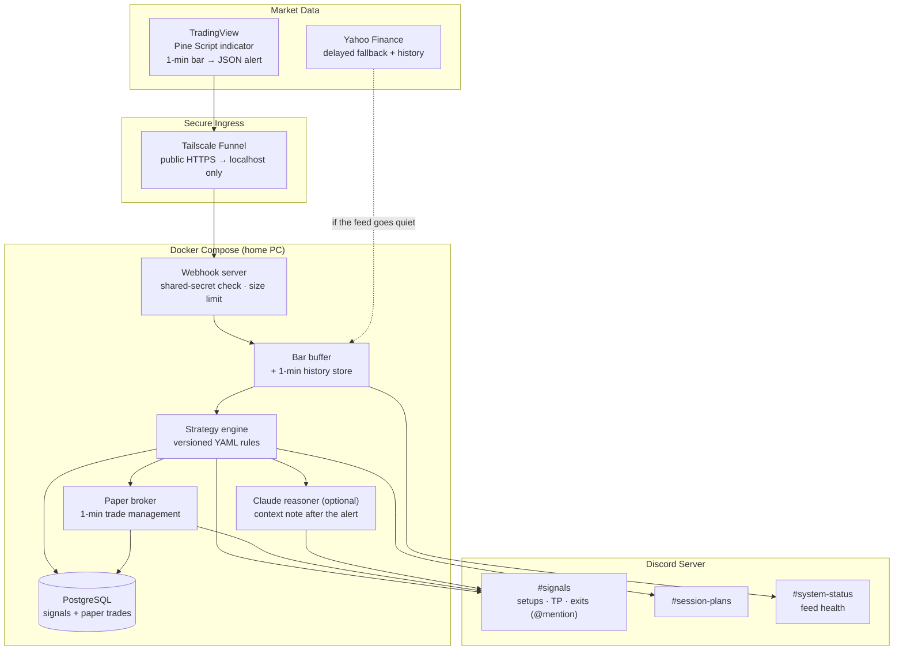

<div align="center">


**A self-hosted, real-time alert system for futures day trading: live market data in, rule-based trade alerts out, with a backtesting lab behind it.**


[](https://github.com/dzenan27)

<br/>


<br/>

**Jump to:**
[Overview](#overview) • [Architecture](#architecture) • [Pipeline](#pipeline) • [Alerts](#alerts) • [Research Lab](#research) • [Build Story](#build) • [Lessons](#lessons) • [Security](#security) • [Setup](#setup) • [Files](#files)

</div>

---

<a id="overview"></a>
## 🔍 What This Does

The Trading Session Assistant watches the futures market minute by minute during the sessions I trade. When my rules line up, it sends a Discord alert with everything needed to place and manage the trade by hand. **It is advisory only and never places orders.**

- ⚡ **Real-time data:** 1-minute bars pushed from TradingView by webhook, landing within seconds of each candle closing
- 🧠 **Rules engine:** a versioned, YAML-configured strategy turns closed candles into session plans and trade setups
- 📲 **Discord delivery:** each message type has its own channel, and the act-now alerts @mention you so they reach your phone
- 🧪 **Research lab:** an event-driven backtester with 1-minute fills, robustness checks and a prop-firm evaluation simulator
- 🐳 **Self-hosted:** runs 24/5 in Docker on a home PC, published through an encrypted tunnel with no open router ports

> 🔒 **The trading strategy itself is private.** This README covers the engineering, not the rules.

---

<a id="architecture"></a>
## 🏗️ System Architecture



<details>
<summary><b>Text version</b></summary>

<br/>

```
MARKET DATA
├── TradingView (Pine Script indicator → 1-min bar as JSON, every minute)
└── Yahoo Finance (delayed fallback + daily history refresh)

SECURE INGRESS
└── Tailscale Funnel (public HTTPS → 127.0.0.1:8080 only)

DOCKER COMPOSE (home PC, restart: unless-stopped)
├── Webhook server     — shared-secret check, body-size limit, localhost bind
├── Bar buffer         — merges real-time bars over fallback data
├── Strategy engine    — versioned YAML rules, closed candles only
├── Paper broker       — manages open trades on 1-minute bars
├── Claude reasoner    — optional context note, sent after the alert
└── PostgreSQL         — every signal and paper trade

DISCORD (one webhook per channel)
├── #signals         — setup cards, take-profit prompts, exits (@mention)
├── #session-plans   — the levels to watch each session
└── #system-status   — feed live / delayed notices (muted)
```

</details>

---

<a id="pipeline"></a>
## ⚙️ How a Signal Flows

| Step | What happens | Design choice |
|---|---|---|
| 1. Bar closes | The TradingView indicator posts the closed 1-minute bar as JSON | Push, not poll: alerts land 1–5 s after the close |
| 2. Ingress | Tailscale Funnel forwards HTTPS to a server bound to `127.0.0.1` | No port forwarding; the PC is never directly exposed |
| 3. Validation | Shared secret (constant-time compare), 4 KB body limit, schema check | Rejected requests log the reason, never the body |
| 4. Buffering | Real-time bars overwrite fallback bars for the same minute | Real-time data wins; fallback only fills gaps |
| 5. Decision | The engine runs on **closed** candles only | No look-ahead: a candle counts once the *data* reaches its end, not the wall clock |
| 6. Alert | A Discord embed with order, stop, targets and dollar risk is posted to its channel | Everything needed to act, in one card |
| 7. Management | The paper broker follows the open trade on 1-minute bars | Take-profit, breakeven and exit prompts arrive within a minute |
| 8. Record | Signals and paper trades go to PostgreSQL and CSV | Live results can be checked against the backtest |

---

<a id="alerts"></a>
## 📲 Alert Design

Alerts are built for one job: placing a trade correctly within seconds, from a phone.

| Message | Channel | Pings phone? | Contents |
|---|---|---|---|
| Session plan | `#session-plans` | No | The levels to watch tonight and whether the session is tradeable |
| Setup card | `#signals` | ✅ @mention | Direction, contracts, entry, stop, targets, bracket (OCO) to place, dollar risk, how to adjust if your fill differs |
| Take-profit prompt | `#signals` | ✅ @mention | What filled and where to move the stop |
| Time-stop reminder | `#signals` | No | Close-out warning before the session ends |
| Exit | `#signals` | No | Outcome in R and dollars |
| Feed status | `#system-status` | No (muted) | Real-time feed live / delayed |

<details>
<summary><b>Example setup card (dummy values)</b></summary>

<br/>

```
🔴 SHORT NQ — session break               Wed 22:00 CT · strategy v2.x
Order        SELL 5 MNQ at market now      Signal close 21,000.00
Stop         21,070.00 · 70.00 pts · −$700 total
Targets      …partial + runner, with exact limit prices…
Bracket      1. Sell 5 MNQ at market  2. Stop  3. Limit  4. Limit (OCO)
Your fill    Keep the stop. Targets = fill ± multiple of R
Risk & day   Risk $700 · day so far +$0 · daily stops
```

</details>

---

<a id="research"></a>
## 🧪 The Research Lab

Every rule change goes through the lab before it reaches the live alerts, and I approve each version first.

| Tool | What it does |
|---|---|
| **Event-driven backtester** | Replays sessions bar by bar with 1-minute fills, commissions and slippage. No look-ahead. |
| **Robustness checks** | Split-half / year-over-year consistency, parameter grids, and a "zero-edge twin" that shows how much of a result is luck |
| **Prop-firm eval simulator** | Models profit target, trailing drawdown, daily loss limit, consistency rule and expiry, across rolling 30-day windows |
| **Monte Carlo forecast** | 10,000 simulated evaluations built by block-resampling real trading days |
| **News blackout** | A calendar of high-impact releases that blocks entries around them |
| **Reports** | HTML reports with equity curves and per-session breakdowns (matplotlib) |

Strategy versions live in `strategies/*.yaml`, with a changelog, so every live alert can be traced to the exact rules that produced it.

---

<a id="build"></a>
## 🛠️ How I Built It

I built this iteratively, using **Claude Code as an AI pair programmer**: I set the goals and constraints and approved every strategy version, and the code was built, tested and reviewed in small steps.

| Phase | What I built |
|---|---|
| **1. Foundation** | Rules engine, risk sizing, Discord alerts, SQLite/PostgreSQL store, Docker Compose |
| **2. Real-time feed** | Pine Script bar-feed indicator, secured webhook server, Tailscale Funnel ingress, stale-feed detection |
| **3. Research lab** | 1-minute backtester, robustness tooling, prop-firm eval simulator, Monte Carlo forecasting |
| **4. Strategy iterations** | Six versions (v2.0 → v2.5), each documented, tested and approved before going live |
| **5. Paper trading live** | Strategy wired into the live service as paper alerts, with warm-up replay on restart |
| **6. Delivery polish** | Per-channel Discord routing, @mention on act-now alerts, phone notification testing |
| **7. Live review** | Every live alert audited against real 1-minute prices; bugs found, fixed and covered by regression tests |

**Quality bar:** 99 automated tests (pytest), regression tests for every live bug, and secrets that never leave `.env`.

---

<a id="lessons"></a>
## 📚 Engineering Lessons

> Production finds what backtests can't. These were all found by auditing live alerts against real prices.

<details open>
<summary><b>🐛 Bugs found in live operation, and the fixes</b></summary>

<br/>

| Problem | Root cause | Fix |
|---|---|---|
| A delayed feed closed a candle early | The engine trusted the wall clock instead of the data | A candle only closes once the data reaches its end (regression test) |
| Trade updates arrived up to an hour late, and one result was wrong | Mid-trade, the data-coverage check failed and fell back to hourly bars | Coverage is judged up to the end of the data, so open trades use 1-minute bars |
| False "feed delayed" warnings | Freshness was measured from a bar's open time, not its arrival | Freshness uses arrival time |
| Signals were silent after a restart | Warm-up replay suppresses old alerts so they aren't re-sent | Documented; a "missed while offline" notice is planned |
| The feed died after reboots | The tunnel waited for a desktop app to start | Planned: run the tunnel in unattended mode |

</details>

<details>
<summary><b>🧭 Takeaways</b></summary>

<br/>

- **Audit live against ground truth.** Logs said "sent"; only comparing them with real prices showed what was wrong.
- **Treat time as data.** Feeds lag, drop and arrive out of order, so every decision keys off data time.
- **Home hosting is the weakest link.** Reboots, crashes and updates caused more missed alerts than code did.
- **Small samples lie.** A few live trades can't confirm or reject a strategy, so the system keeps logging until the sample means something.

</details>

---

<a id="security"></a>
## 🔐 Security & Privacy

| Control | Implementation |
|---|---|
| Secrets | Only in `.env` (git-ignored); `.env.example` holds names, never values |
| Webhook auth | Shared secret checked in constant time; the Pine input is hidden from the chart (`display.none`) |
| Request hardening | 4 KB body limit, schema validation, request bodies never logged |
| Network exposure | Server bound to `127.0.0.1`; public HTTPS only through Tailscale Funnel |
| Secret rotation | Rotated after setup; the old alert and indicator were removed |
| Advisory only | No broker API keys and no order placement anywhere in the code |

---

<a id="setup"></a>
## ⚙️ Setup

<details open>
<summary><b>🐳 Run the service</b></summary>

<br/>

```bash
git clone <this repo> && cd trading-session-assistant
cp .env.example .env        # fill in your own values (see below)
docker compose up -d --build
docker compose logs -f assistant
```

</details>

<details>
<summary><b>🌐 Publish the webhook</b></summary>

<br/>

```bash
tailscale funnel --bg 8080      # public HTTPS → localhost:8080
tailscale set --unattended      # keep it running after reboots (Windows)
```

Then add `tradingview/session_assistant_bar_feed.pine` to a 1-minute chart, paste your webhook secret into its hidden input, and create an alert ("Any alert() function call") that posts to `https://<your-funnel-host>/tv/bar`.

</details>

<details>
<summary><b>🧪 Tests and backtests</b></summary>

<br/>

```bash
python -m venv .venv && .venv/Scripts/pip install -r requirements-dev.txt
.venv/Scripts/python -m pytest -q
.venv/Scripts/python -m a4h --help
```

</details>

### 🔑 Configuration (names only)

| Variable | Purpose |
|---|---|
| `TV_WEBHOOK_SECRET` | Shared secret between the Pine indicator and the webhook |
| `DISCORD_WEBHOOK_URL` | Default Discord channel |
| `DISCORD_WEBHOOK_*` | Optional per-channel routing (signals, plans, status) |
| `ANTHROPIC_API_KEY` | Optional Claude context notes |
| `POSTGRES_PASSWORD` | Database password |
| `FEED` / `STALE_FEED_MINUTES` | Data source and outage detection |

---

<a id="files"></a>
## 📁 Project Files

```
trading-session-assistant/
├── assistant/                     # Live service
│   ├── __main__.py                # CLI: live, backtest, demo-alert, check
│   ├── live.py                    # Main loop
│   ├── webhook.py                 # Secured TradingView webhook server + bar buffer
│   ├── feeds.py                   # Real-time and fallback data feeds
│   ├── a4h_paper.py               # Bridge: strategy engine → paper alerts
│   ├── alerts.py                  # Discord embeds
│   ├── reasoner.py                # Optional Claude context notes
│   ├── store.py                   # PostgreSQL / SQLite persistence
│   └── config.py                  # .env loading + per-channel routing
├── a4h/                           # Strategy engine + research lab (rules private)
│   ├── data.py · indicators.py    # Data loading, resampling, indicators
│   ├── execution.py               # Paper broker (fills, stops, targets)
│   ├── backtest.py · metrics.py   # Backtester + performance stats
│   ├── evalsim.py                 # Prop-firm evaluation simulator
│   ├── robustness.py · report*.py # Robustness checks + HTML reports
│   ├── live.py · alerts.py        # Live watcher + Discord order tickets
│   └── news_events.csv            # High-impact news blackout calendar
├── strategies/                    # Versioned YAML strategy configs + changelog
├── scripts/                       # Research and forecasting scripts
├── tradingview/
│   └── session_assistant_bar_feed.pine   # 1-minute bar feed indicator
├── tests/                         # 99 pytest tests
├── docs/OPERATIONS.md             # Private operating manual
├── Dockerfile · docker-compose.yml
└── .env.example                   # Config names only, no values
```

---

<div align="center">

*Trading Session Assistant is a personal portfolio project. It is advisory only, places no orders, and nothing here is financial advice.*

[](https://github.com/dzenan27)
[](https://www.linkedin.com/in/dzenanm)


</div>
